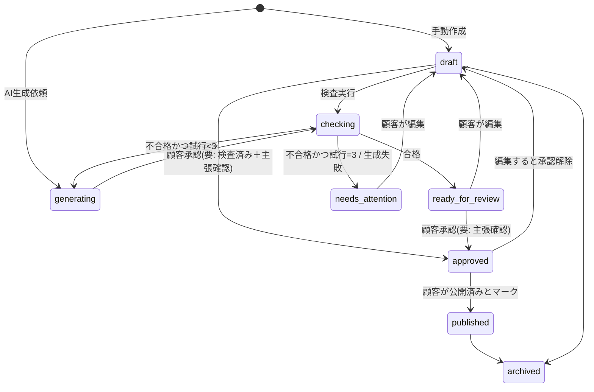

# 1. 製品要件定義書（PRD）

## 1.1 背景と目的

個人事業主・小規模事業者は、ブログやSNSの継続的な発信が集客に重要だと理解していても、企画・執筆・品質確認・スケジュール管理に時間を割けない。AICraft は、事業者のブランド設定に沿ったコンテンツを AI が企画・下書き・検査し、事業者は「確認して承認するだけ」で発信を継続できる状態を提供する。

同時に、AICraft 自体の運営（開発・営業・顧客対応・監視）も AI エージェントで大部分を自動化し、安定稼働後の人間の定常運営時間を **週1時間程度** に抑える。ただし品質と安全性を優先し、自動化率は二次目標とする。

## 1.2 対象顧客（ペルソナ）

| ID | ペルソナ | 主な課題 | 主な利用 |
|---|---|---|---|
| P1 | 個人サロン経営者（美容・整体等） | 週1回のブログと毎日のInstagram投稿が続かない | SNS投稿案の一括生成、カレンダー |
| P2 | 士業・コンサル（個人） | 専門性のある記事を書きたいが時間がない。誤情報が怖い | ブログ記事下書き、主張の確認リスト |
| P3 | 小規模EC・飲食店（従業員〜10名） | 担当者が兼任で、トーンがばらつく | ブランド設定、複数メンバーでの編集・承認 |

**対象外（MVP）**: 代理店の多顧客管理、英語など多言語、医療・金融等の規制業種向けの専門審査保証。

## 1.3 提供価値と機能要件

優先度: **M** = MVP必須 / **S** = MVP後すぐ / **L** = 将来

### A. ブランド設定
| ID | 要件 | 優先 |
|---|---|---|
| A-1 | 事業概要、ターゲット顧客、トーン（例: 親しみやすい／専門的）、文体（です・ます／だ・である）、NGワード、必須表記、参考文例を登録できる | M |
| A-2 | ブランド設定はバージョン管理され、どの版で生成されたかがコンテンツに記録される | M |
| A-3 | 業種テンプレートから初期値を作成できる | S |

### B. コンテンツ企画・生成
| ID | 要件 | 優先 |
|---|---|---|
| B-1 | テーマ・目的・チャネル（ブログ / X / Instagram キャプション / Facebook / 汎用）を指定してコンテンツ案（タイトル＋概要）を最大10件提案 | M |
| B-2 | 案から本文を生成。チャネルごとに文字数・構成ルールを適用 | M |
| B-3 | 生成ごとに品質検査（機械検査＋独立AIレビュー）を自動実行し、結果をスコアと指摘で表示 | M |
| B-4 | 不合格時は最大2回自動再生成（計3回試行）。改善しなければ「要確認」ステータスで指摘付きで提示 | M |
| B-5 | 本文中の「事実確認が必要な主張」（数値・統計・法令・効果効能・固有名詞の事実）を抽出しリスト表示 | M |
| B-6 | 選択範囲の書き直し（短く／丁寧に／具体的に） | S |
| B-7 | 月間コンテンツ計画の自動提案 | S |

### C. 編集・保存・履歴・カレンダー
| ID | 要件 | 優先 |
|---|---|---|
| C-1 | リッチテキスト（Markdown）エディタで編集・保存 | M |
| C-2 | 保存ごとにバージョンを作成し、差分表示と任意版への復元ができる | M |
| C-3 | ステータス管理（後述の状態遷移） | M |
| C-4 | カレンダーで公開予定日を設定・ドラッグ変更 | M |
| C-5 | 承認済みコンテンツのコピー／Markdown・テキストエクスポート | M |
| C-6 | 公開済みマーク（顧客が手動で公開した事実の記録）と公開URLの記録 | M |
| C-7 | 外部SNS・CMSへの自動投稿 | L（各API規約確認後。承認必須） |

### D. 品質評価
| ID | 要件 | 優先 |
|---|---|---|
| D-1 | 各コンテンツに品質スコア（0–100）と項目別評価、指摘一覧を表示 | M |
| D-2 | 指摘ごとに「対応済み」「無視（理由）」を記録 | S |

### E. レポート
| ID | 要件 | 優先 |
|---|---|---|
| E-1 | 月次レポート: 生成数、承認数、公開数、平均品質スコア、再生成率、利用枠消費 | M |
| E-2 | 公開URLの成果（PV・エンゲージメント）の手動入力と推移表示 | S |
| E-3 | 外部アナリティクス連携 | L |

### F. アカウント・課金
| ID | 要件 | 優先 |
|---|---|---|
| F-1 | メール＋パスワード／マジックリンクでサインアップ・ログイン | M |
| F-2 | ワークスペース（テナント）作成、メンバー招待（owner / editor / viewer） | M（招待はS可） |
| F-3 | Stripe によるサブスクリプション（14日トライアル想定）、カスタマーポータル | M |
| F-4 | 利用枠（月間生成数）の表示と超過時の制限 | M |
| F-5 | アカウント削除申請（データエクスポート後に削除） | M |

### G. サポート
| ID | 要件 | 優先 |
|---|---|---|
| G-1 | ヘルプセンター（FAQ記事） | M |
| G-2 | 問い合わせフォーム → AI分類 → FAQで解決可能なものは根拠付き自動回答、それ以外は回答案作成＋人間へエスカレーション | M |

## 1.4 コンテンツの状態遷移

- `approved` への遷移条件: (1) 最新バージョンが品質検査済み、(2) 重大(critical)指摘がない、または顧客が理由付きで上書き、(3) 抽出された全主張に顧客が確認チェック済み。
- 承認後に本文を編集すると自動で `draft` に戻る（承認済み内容と実体の不一致を防ぐ）。

## 1.5 非機能要件

| 区分 | 要件 | 検証方法 |
|---|---|---|
| 可用性 | 月間稼働率目標 99.5%（外部依存の障害を除く） | 外形監視の記録 |
| 性能 | 画面表示 p95 < 2秒、生成完了 p95 < 90秒（ブログ）/ 30秒（SNS） | 計測ログ |
| 分離 | テナント間のデータアクセスが0件（RLSテストで全テーブル検証） | 自動テスト |
| 監査 | AIの全ツール呼び出し・全承認操作・管理操作を監査ログに記録、1年保持 | ログ検査 |
| コスト | テナント別・全体の日次LLM予算上限。上限到達で生成停止 | 負荷テスト |
| 保護 | 個人情報保護法に沿ったプライバシーポリシー、外国事業者への提供の明示（要法務確認） | 法務レビュー |
| アクセシビリティ | 主要画面でキーボード操作可能、コントラスト比 4.5:1 以上 | axe 自動検査 |

## 1.6 料金プラン（仮案・金額未定）

| プラン | 月間生成数 | メンバー | 備考 |
|---|---|---|---|
| Free Trial（14日） | 20 | 1 | カード登録の要否は要決定 |
| Starter | 60 | 1 | |
| Pro | 200 | 3 | |

「1生成」= 本文1件の生成（自動再生成・品質検査を含む）。金額は [11](11-cost-operations-unverified.md) の原価試算確定後に決める。

## 1.7 成功指標（KPI）

| 指標 | MVP目標（ベータ3か月） |
|---|---|
| 生成→承認率 | ≥ 60% |
| 初回生成の品質合格率 | ≥ 80% |
| 顧客に届いた重大誤情報インシデント | 0件 |
| テナント間データ漏えい | 0件 |
| 1生成あたりLLM原価 | プラン単価の15%以下 |
| 人間の定常運営時間 | ベータ中は計測のみ。安定稼働後 週1時間を目標 |

## 1.8 スコープ外（MVP）

外部SNS/CMSへの自動投稿、画像生成、多言語、代理店向け多顧客管理、ネイティブアプリ、営業メールの自動送信。
