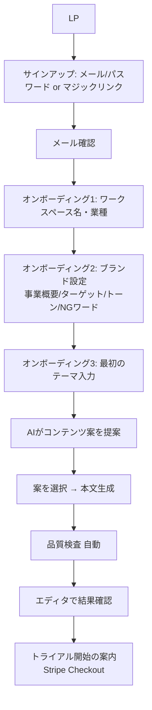
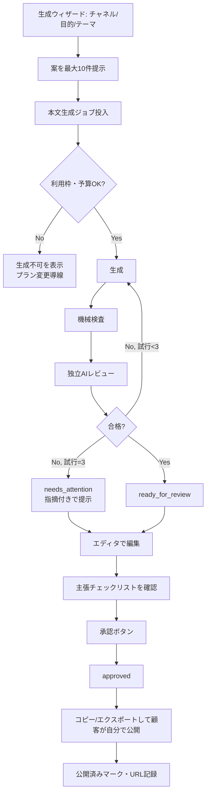
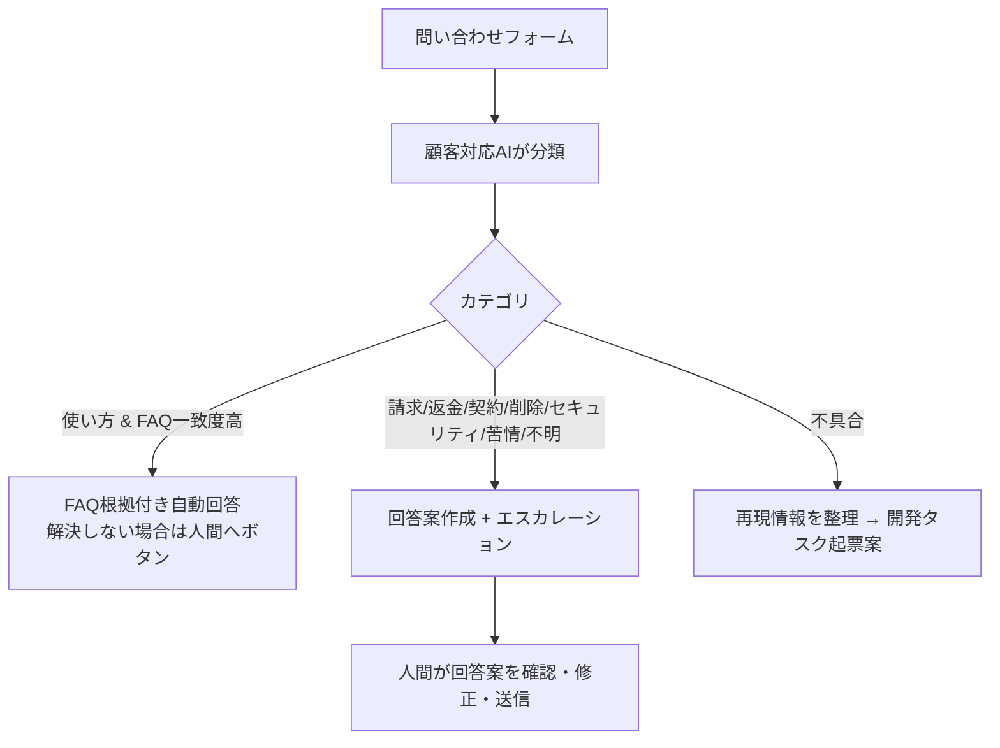

# 2. ユーザーフローと画面一覧

## 2.1 主要ユーザーフロー

### F1. サインアップ〜初回生成

### F2. コンテンツ生成〜承認〜公開（中核フロー）

### F3. 問い合わせ

### F4. アカウント削除

マイページ → データエクスポート案内 → 削除申請（パスワード再確認）→ 即時ログイン不可・サブスクリプション解約 → 運営者承認 → 完全削除（保持期間は [08](08-security-and-incident-response.md) 参照）→ 完了メール。

### F5. 運営者（人間）の週次フロー

管理コンソール → 承認キュー処理 → 週次レポート確認 → 品質監査サンプル確認 → エスカレーション対応（目標合計 約60分）。

## 2.2 顧客向け画面一覧

| ID | 画面 | パス（案） | 主要要素 | ロール | MVP |
|---|---|---|---|---|---|
| S-01 | LP | `/` | 価値説明、料金、CTA、特商法表記リンク | 公開 | M |
| S-02 | サインアップ / ログイン | `/signup`, `/login` | メール、パスワード、マジックリンク | 公開 | M |
| S-03 | パスワード再設定 | `/reset-password` | | 公開 | M |
| S-04 | オンボーディング | `/onboarding` | 3ステップ（ワークスペース/ブランド/初回テーマ） | owner | M |
| S-05 | ダッシュボード | `/app` | 今週の予定、要確認件数、利用枠、最近のコンテンツ | 全員 | M |
| S-06 | コンテンツ一覧 | `/app/contents` | フィルタ（ステータス/チャネル/期間）、検索 | 全員 | M |
| S-07 | 生成ウィザード | `/app/generate` | チャネル、目的、テーマ、案一覧、生成ボタン | owner, editor | M |
| S-08 | エディタ | `/app/contents/[id]` | 本文編集、品質パネル（スコア/指摘）、主張チェックリスト、バージョン履歴、承認ボタン、エクスポート | 閲覧は全員、編集・承認は owner, editor | M |
| S-09 | バージョン差分 | `/app/contents/[id]/versions` | 差分表示、復元 | owner, editor | M |
| S-10 | カレンダー | `/app/calendar` | 月/週表示、D&D日程変更 | 全員（変更は editor以上） | M |
| S-11 | ブランド設定 | `/app/brand` | 各項目、版履歴 | owner, editor | M |
| S-12 | レポート | `/app/reports` | 月次指標、成果手動入力 | 全員 | M |
| S-13 | メンバー管理 | `/app/settings/members` | 招待、ロール変更、削除 | owner | S |
| S-14 | 請求・プラン | `/app/settings/billing` | 現プラン、利用枠、Stripeポータルへ | owner | M |
| S-15 | アカウント設定 | `/app/settings/account` | プロフィール、パスワード、データエクスポート、削除申請 | 本人 | M |
| S-16 | ヘルプセンター | `/help` | FAQ記事検索 | 公開 | M |
| S-17 | 問い合わせ | `/app/support` | フォーム、過去のやりとり | 全員 | M |
| S-18 | 利用規約 / プライバシー / 特商法 | `/legal/*` | | 公開 | M |

## 2.3 運営者向け管理コンソール（内部）

アクセス条件: `ops_admins` テーブル登録者のみ ＋ MFA必須。顧客データの本文閲覧は「サポート対応で顧客同意あり」の場合のみ、理由入力を必須にして監査ログに記録。

| ID | 画面 | パス（案） | 主要要素 | MVP |
|---|---|---|---|---|
| A-01 | 運営ダッシュボード | `/ops` | 稼働状況、本日のLLMコスト/予算、エラー率、未処理承認数、未対応チケット | M |
| A-02 | 承認キュー | `/ops/approvals` | 申請内容、リスク区分、根拠、差分/プレビュー、承認・却下（理由必須） | M |
| A-03 | チケット | `/ops/tickets` | AI分類、回答案、送信、エスカレーション理由 | M |
| A-04 | エージェント実行ログ | `/ops/agents` | 実行一覧、ツール呼び出し、失敗、停止スイッチ | M |
| A-05 | 品質監査 | `/ops/quality` | 週次サンプル、人間評価入力、AI評価との一致率 | M |
| A-06 | 評価セット結果 | `/ops/evals` | 回帰テスト履歴、閾値比較 | M |
| A-07 | コスト・利用状況 | `/ops/usage` | テナント別消費、異常検知、予算設定 | M |
| A-08 | インシデント | `/ops/incidents` | 起票、重大度、タイムライン、事後レビュー | M |
| A-09 | 機能フラグ / キルスイッチ | `/ops/flags` | AI生成停止、自動回答停止、各エージェント停止 | M |
| A-10 | 営業・マーケ案 | `/ops/marketing` | 市場調査メモ、コンテンツ案、見込み客リスト案、提案文案（送信機能なし） | S |
