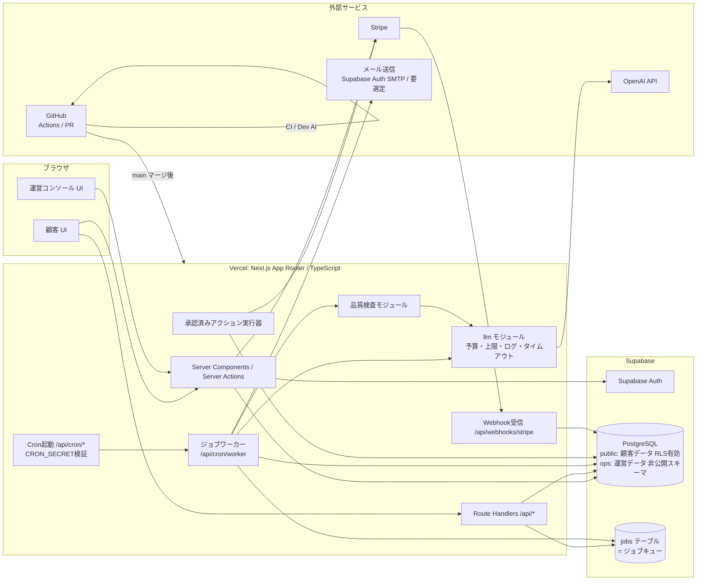
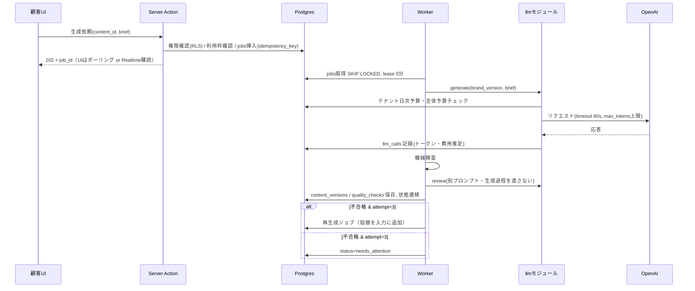

# 3. システム構成図

## 3.1 全体構成



## 3.2 構成要素と選定理由

| 要素 | 採用 | 役割 | 最小化の理由・代替 |
|---|---|---|---|
| Web/API | Next.js App Router + TypeScript on Vercel | UI、Server Actions、Route Handlers、Cron | 1リポジトリ1デプロイで完結 |
| 認証 | Supabase Auth | メール/マジックリンク、セッション | DBのRLSと `auth.uid()` で直結 |
| DB | Supabase PostgreSQL + RLS | 全データ、テナント分離 | |
| ジョブキュー | Postgres `jobs` テーブル（`FOR UPDATE SKIP LOCKED`） | 生成・検査・レポート・監視 | 専用キュー（Redis等）を入れない。負荷増大時に再検討 |
| スケジューラ | Vercel Cron（または Supabase pg_cron） | 毎分ワーカー起動、日次/週次ジョブ | 実行頻度・実行時間の上限はプラン依存で**未検証**（U-05） |
| LLM | OpenAI API（`llm` モジュール経由のみ） | 生成、レビュー、分類 | 直接SDK呼び出しを lint で禁止 |
| 課金 | Stripe Checkout / Customer Portal / Webhook | サブスクリプション | 自前の請求UIを作らない |
| メール | Supabase Auth のSMTP設定 + トランザクションメール1社（未選定） | 認証メール、通知、サポート返信 | 選定は未決定（U-12） |
| CI / 開発AI | GitHub Actions | lint/型/テスト/RLSテスト/評価回帰、開発AIの実行 | |
| 監視 | Vercel ログ + DB上のメトリクス集計 + 外形監視（無料枠の1サービス、未選定） | エラー・コスト・稼働 | APMは必要になるまで入れない |

## 3.3 生成パイプライン（シーケンス）



## 3.4 環境

| 環境 | 用途 | DB | LLM | Stripe |
|---|---|---|---|---|
| local | 開発 | Supabase CLI ローカル | モック or 開発キー（低予算上限） | テストモード |
| preview | PRごと（Vercel Preview） | staging DB（共有、テストデータのみ） | 開発キー | テストモード |
| staging | 受け入れ確認・復元訓練 | staging プロジェクト | 開発キー | テストモード |
| production | 本番 | production プロジェクト | 本番キー（プロジェクト単位の上限設定） | ライブモード |

- 本番の秘密情報は Vercel の Production 環境変数のみに置き、Preview/開発AIからは参照不可。
- DBマイグレーションは `supabase/migrations` に SQL で管理。本番適用は人間承認後に GitHub Actions の手動ワークフローで実行。

## 3.5 リポジトリ構成（案・新規リポジトリ想定）

```
aicraft/
  app/                  # Next.js App Router（(marketing), (app), ops, api）
  lib/
    llm/                # 唯一のLLM呼び出し口（予算・上限・ログ）
    qa/                 # 機械検査・AIレビュー
    agents/             # 各エージェント定義（ツール許可リスト）
    approvals/          # 承認申請・実行器
    jobs/               # キュー・ワーカー
    db/                 # 型付きクライアント
  supabase/migrations/  # SQL
  supabase/tests/       # RLSテスト（pgTAP）
  evals/                # 評価セットと実行スクリプト
  tests/                # unit / integration / e2e (Playwright)
  .github/workflows/
  docs/
```
