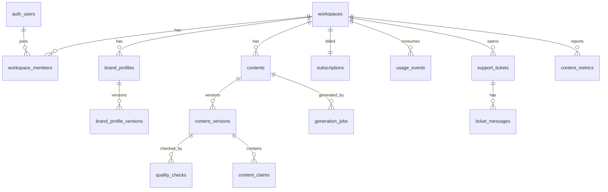

# 4. データベース設計

## 4.1 方針

- **テナント = `workspaces`**。顧客データを持つ全テーブルに `workspace_id uuid not null` を持たせ、RLSで分離する。
- スキーマ分離: `public`（顧客データ・RLS有効・PostgREST公開）／ `ops`（運営データ・PostgREST非公開、サーバーのサービスロールのみ）。
- 全テーブル共通列: `id uuid pk default gen_random_uuid()`, `created_at timestamptz default now()`, `updated_at timestamptz`。論理削除対象は `deleted_at timestamptz`。
- サービスロールキーはワーカー・実行器のみが使用し、その場合も **アプリ側で必ず `workspace_id` を明示指定**（RLSをバイパスするため）。これを lint ルールとコードレビュー観点にする。

## 4.2 ER図（主要部分）



## 4.3 テーブル定義（public スキーマ / 顧客データ）

| テーブル | 主な列 | 備考 |
|---|---|---|
| `profiles` | `user_id`(pk, = auth.users.id), `display_name`, `locale` | 本人のみ読み書き |
| `workspaces` | `name`, `industry`, `plan`(trial/starter/pro/canceled), `status`(active/suspended/pending_deletion), `deleted_at` | |
| `workspace_members` | `workspace_id`, `user_id`, `role`(owner/editor/viewer), unique(workspace_id,user_id) | owner は最低1名（トリガで保証） |
| `workspace_invitations` | `workspace_id`, `email`, `role`, `token_hash`, `expires_at`, `accepted_at` | トークンはハッシュ保存 |
| `brand_profiles` | `workspace_id`, `name`, `current_version_id` | MVPは1ワークスペース1件 |
| `brand_profile_versions` | `brand_profile_id`, `workspace_id`, `version`(int), `business_summary`, `target_audience`, `tone`, `writing_style`, `ng_words text[]`, `required_phrases text[]`, `sample_texts text[]`, `created_by` | 更新不可（INSERTのみ） |
| `contents` | `workspace_id`, `channel`(blog/x/instagram/facebook/generic), `title`, `status`(4.6参照), `current_version_id`, `approved_version_id`, `scheduled_at`, `published_at`, `published_url`, `created_by`, `deleted_at` | |
| `content_versions` | `content_id`, `workspace_id`, `version`, `body_md`, `source`(ai/human), `brand_version_id`, `generation_job_id`, `body_sha256`, `created_by` | 更新不可。承認は `body_sha256` に紐付け |
| `content_claims` | `content_version_id`, `workspace_id`, `claim_text`, `claim_type`(number/statistic/law/efficacy/proper_noun/other), `risk`(low/high), `confirmed_by`, `confirmed_at` | 承認条件: 全件 confirmed |
| `quality_checks` | `content_version_id`, `workspace_id`, `attempt`, `rule_results jsonb`, `review_scores jsonb`, `total_score`(0–100), `verdict`(pass/fail/error), `critical_flags text[]`, `reviewer_model`, `rubric_version` | |
| `quality_overrides` | `quality_check_id`, `workspace_id`, `flag`, `reason`, `user_id` | critical指摘を顧客が理由付きで上書きした記録 |
| `generation_jobs` | `workspace_id`, `content_id`, `kind`(ideas/body/rewrite), `brief jsonb`, `attempt`, `status`, `error_code`, `idempotency_key` unique | 顧客可視のジョブ状態 |
| `content_ideas` | `workspace_id`, `generation_job_id`, `title`, `summary`, `channel`, `used_content_id` | |
| `content_metrics` | `content_id`, `workspace_id`, `date`, `views`, `engagements`, `source`(manual) | |
| `usage_events` | `workspace_id`, `kind`(generation/review/rewrite), `units`, `llm_call_id`, `period_month` | 利用枠集計の元 |
| `subscriptions` | `workspace_id` unique, `stripe_customer_id`, `stripe_subscription_id`, `status`, `price_id`, `current_period_end`, `cancel_at` | 書込はWebhook（サービスロール）のみ |
| `support_tickets` | `workspace_id`, `user_id`, `subject`, `category`, `priority`, `status`(open/auto_answered/waiting_human/answered/closed), `ai_confidence`, `escalation_reason` | |
| `ticket_messages` | `ticket_id`, `workspace_id`, `author_type`(customer/ai/human), `body`, `sent_at`, `draft`(bool) | 顧客には `draft=false` のみ表示 |
| `faq_articles` | `slug`, `title`, `body_md`, `published`, `version` | 全体公開（テナント非依存）。更新は運営のみ |
| `data_requests` | `workspace_id`, `user_id`, `kind`(export/delete_account), `status`, `approval_request_id`, `completed_at` | |
| `notifications` | `user_id`, `workspace_id`, `kind`, `payload jsonb`, `read_at` | |

## 4.4 テーブル定義（ops スキーマ / 運営データ）

| テーブル | 主な列 | 備考 |
|---|---|---|
| `ops.admins` | `user_id`, `role`(owner/operator), `mfa_required` | 管理コンソールの認可元 |
| `ops.jobs` | `queue`, `payload jsonb`, `workspace_id`(nullable), `status`(queued/running/succeeded/failed/dead), `attempts`, `max_attempts`, `run_after`, `locked_until`, `last_error`, `idempotency_key` unique | キュー本体 |
| `ops.llm_calls` | `workspace_id`, `agent`, `purpose`, `model`, `input_tokens`, `output_tokens`, `est_cost_usd numeric`, `latency_ms`, `status`, `prompt_version` | **プロンプト本文・顧客本文は保存しない**（ハッシュのみ） |
| `ops.budgets` | `scope`(global/workspace/agent), `scope_id`, `daily_limit_usd`, `monthly_limit_usd`, `hard_stop bool` | |
| `ops.agent_runs` | `agent`, `trigger`, `status`, `started_at`, `finished_at`, `summary`, `error` | |
| `ops.agent_tool_calls` | `agent_run_id`, `tool`, `args_redacted jsonb`, `result_status`, `denied_reason` | 許可外ツールの拒否も記録 |
| `ops.approval_requests` | `requested_by_agent`, `action_type`, `risk_level`(medium/high/critical), `payload jsonb`, `payload_sha256`, `rationale`, `status`(pending/approved/rejected/expired/executed/failed), `decided_by`, `decided_at`, `decision_reason`, `expires_at`, `executed_at` | 09章参照 |
| `ops.audit_logs` | `actor_type`(user/admin/agent/system), `actor_id`, `workspace_id`, `action`, `target_type`, `target_id`, `metadata jsonb`, `ip_hash` | INSERTのみ（UPDATE/DELETE権限を誰にも付与しない） |
| `ops.incidents` | `severity`(SEV1/2/3), `title`, `status`, `detected_by`, `timeline jsonb`, `postmortem_md` | |
| `ops.feature_flags` | `key`, `enabled`, `scope`, `updated_by` | キルスイッチ |
| `ops.eval_sets` / `ops.eval_cases` / `ops.eval_runs` / `ops.eval_results` | ケース入力、期待条件、実行ごとのスコア | 07章参照 |
| `ops.human_audits` | `quality_check_id`, `auditor`, `human_verdict`, `human_scores jsonb`, `notes` | AI評価との一致率算出 |
| `ops.marketing_items` | `kind`(research/idea/lead/proposal), `body`, `source_urls`, `status`(draft/approved/rejected) | 送信機能なし |
| `ops.metrics_daily` | `date`, `metric`, `value`, `dims jsonb` | 監視AIの集計結果 |

## 4.5 RLS ポリシー設計

ヘルパー関数（`security definer`, `stable`, `search_path` 固定）:

```sql
create function public.is_member(ws uuid) returns boolean ...
  -- exists(select 1 from workspace_members where workspace_id = ws and user_id = auth.uid())
create function public.has_role(ws uuid, roles text[]) returns boolean ...
```

| テーブル | SELECT | INSERT | UPDATE | DELETE |
|---|---|---|---|---|
| workspaces | is_member | 認証済み（作成者を owner として同一トランザクションで登録するRPC経由のみ） | has_role(owner) | 不可（削除は data_requests 経由） |
| workspace_members | is_member | has_role(owner) | has_role(owner) | has_role(owner)、最後のownerは不可 |
| brand_profile_versions | is_member | has_role(owner,editor) | 不可 | 不可 |
| contents | is_member かつ deleted_at is null | has_role(owner,editor) | has_role(owner,editor)。`status→approved` は専用RPC `approve_content()` のみ | 論理削除のみ（UPDATE） |
| content_versions | is_member | has_role(owner,editor) かつ source='human'（AI版はサービスロール） | 不可 | 不可 |
| content_claims | is_member | サービスロール | `confirmed_*` のみ has_role(owner,editor)（列権限で制限） | 不可 |
| quality_checks / generation_jobs / usage_events | is_member | サービスロール | サービスロール | 不可 |
| subscriptions | has_role(owner) | サービスロール | サービスロール | 不可 |
| support_tickets / ticket_messages | is_member（messages は draft=false のみ） | is_member（customer 発言のみ） | 不可 | 不可 |
| faq_articles | published=true は全員 | ops のみ | ops のみ | ops のみ |

- `approve_content(content_id, version_id)` RPC: 呼び出し者ロール、最新版一致、品質検査済み、critical未解決なし（または override 記録あり）、全主張 confirmed を検証し、`approved_version_id` と監査ログを1トランザクションで記録する。
- **RLSテスト**: 全 public テーブルについて「別テナントのユーザー」「viewer」「未認証」の3主体で SELECT/INSERT/UPDATE/DELETE を試行し、期待どおり拒否されることを pgTAP で検証（CI必須）。RLS未有効のテーブルが存在したら CI 失敗にするチェックも入れる。

## 4.6 列挙値

- `contents.status`: `draft`, `generating`, `checking`, `ready_for_review`, `needs_attention`, `approved`, `published`, `archived`
- `ops.jobs.queue`: `generate_ideas`, `generate_body`, `quality_check`, `support_triage`, `monthly_report`, `ops_monitor`, `purge_deleted`, `eval_run`

## 4.7 データ保持

| データ | 保持 |
|---|---|
| 顧客コンテンツ（論理削除後） | 30日後に完全削除（D6の決定次第） |
| 解約ワークスペース | 解約後90日でデータ削除の案内 → 承認後削除（要法務確認） |
| audit_logs | 1年（以降はアーカイブ or 削除。要決定） |
| llm_calls | 180日（本文なしのメタデータのみ） |
| 請求記録 | Stripe 側に保持。法定保存期間は要確認（U-17） |
