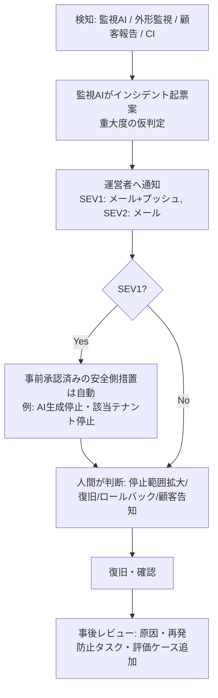

# 8. セキュリティ・障害対応設計

## 8.1 脅威と対策一覧

| # | 脅威 | 対策 | 検証方法 |
|---|---|---|---|
| T1 | テナント間データ漏えい | 全publicテーブルRLS、`is_member` ヘルパー、サービスロール使用時の workspace_id 明示必須（lint）、RLSテスト | pgTAP（3主体×全操作）、CIでRLS未有効検出 |
| T2 | 認証情報の漏えい | 秘密はVercel/Supabase/GitHubの環境変数・Secretsのみ。`.env*` は gitignore。シークレットスキャン（CI＋push protection） | CIのスキャン、リポジトリ検査 |
| T3 | プロンプトインジェクション（ブランド設定・問い合わせ・Webページ・Issue経由） | 区切りタグ＋「データとして扱う」指示、信頼できない入力を扱う実行には外部送信ツールを与えない、出力側の機械検査（R-12等）、承認境界 | E-adversarial 評価セット |
| T4 | エージェントの権限逸脱 | ツール許可リスト、実行器はペイロードハッシュ一致時のみ実行、GitHub側のブランチ保護、最小権限トークン | 権限テスト（許可外ツール呼び出しが拒否されログされる） |
| T5 | LLMコスト暴走（攻撃・バグ・ループ） | テナント日次上限、全体日次上限（ハード停止）、エージェント別上限、max_tokens、ステップ上限、OpenAI側のプロジェクト上限（機能有無は要確認） | 負荷テストで上限停止を確認 |
| T6 | 不正なWebhook | Stripe署名検証、イベントID重複排除、イベントの再取得で状態確認 | 統合テスト |
| T7 | アカウント乗っ取り | Supabase Auth、パスワード強度、ログイン試行レート制限、運営者はMFA必須、重要操作（削除申請・メール変更）は再認証 | E2E、設定確認 |
| T8 | XSS / インジェクション | Markdownレンダリングはサニタイズ（許可タグのみ）、CSP、SQLはパラメータ化のみ | 自動テスト、CSPヘッダ確認 |
| T9 | CSRF | Server Actions のオリジン検証、Route Handlers は SameSite Cookie＋Origin確認 | テスト |
| T10 | 運営者による不適切閲覧 | 顧客本文閲覧は一時許可＋理由＋監査ログ、`ops.audit_logs` はINSERTのみ | 監査ログ検査 |
| T11 | LLMプロバイダへのデータ送信 | 送信は生成・レビューに必要な最小限。学習利用・保持の条件は要確認（U-03）。プライバシーポリシーに明記 | 法務レビュー |
| T12 | サプライチェーン | lockfile固定、Dependabot（PRは人間マージ）、開発AIは新規依存追加時にPRで明示 | CI |

## 8.2 認証情報の管理

| 秘密 | 保管場所 | 参照可能 |
|---|---|---|
| `SUPABASE_SERVICE_ROLE_KEY` (prod) | Vercel Production env | 本番サーバーのみ |
| `OPENAI_API_KEY` (prod) | Vercel Production env | 本番サーバーのみ |
| `OPENAI_API_KEY` (dev) | Vercel Preview env / GitHub Secrets（低上限） | Preview、CI |
| `STRIPE_SECRET_KEY` / `STRIPE_WEBHOOK_SECRET` (live) | Vercel Production env | 本番サーバーのみ |
| `CRON_SECRET` | Vercel env | Cronエンドポイント |
| GitHub App 秘密鍵（開発AI） | GitHub Secrets（Environment保護） | 開発AIワークフローのみ |

- ローテーション: 年1回＋漏えい疑い時は即時。手順書を `docs/runbooks/rotate-secrets.md` に作成（Phase 6）。
- ログ出力時は秘密・トークン・メール・本文をマスキングするロガーを使う。

## 8.3 監査ログ・上限・タイムアウト・再試行

| 処理 | タイムアウト | 再試行 | 上限 |
|---|---|---|---|
| OpenAI 呼び出し | 60秒（レビュー30秒） | 429/5xx のみ最大2回、指数バックオフ＋ジッタ | max_tokens 固定値、1ジョブ最大LLM呼び出し 8回 |
| ジョブ | lease 5分 | `max_attempts=3`、超過で `dead` → 監視AIが通知 | 1ワーカー起動あたり処理件数上限 |
| エージェント実行 | 全体 5分（開発AIは 30分） | 2回 | ステップ数 20 |
| Stripe API | 15秒 | 冪等キー付きで2回 | |
| メール送信 | 10秒 | 3回 | 1ユーザー1日 20通 |

監査ログに記録する操作: ログイン失敗の連続、ロール変更、招待、ブランド設定変更、承認・上書き、エクスポート、削除申請、全エージェントツール呼び出し、承認キュー決定、フラグ変更、予算変更、運営者の顧客データ閲覧。

## 8.4 予算・異常使用の検知

| 検知 | 閾値（初期値） | 自動アクション | 通知 |
|---|---|---|---|
| 全体日次LLM費用 | 予算の 50% / 80% / 100% | 100%で新規生成停止 | 50%情報, 80%警告, 100%緊急 |
| テナント時間当たり消費 | 7日平均の10倍超 かつ 絶対閾値超 | 当該テナント生成一時停止 | 警告 |
| テナント日次上限 | プラン別（例: 月間枠の1/5） | 当日の生成を拒否（UIで案内） | なし（顧客表示のみ） |
| エラー率 | 5分間で5xx > 5% | なし | 警告 |
| ジョブ滞留 | queued が15分以上 > 50件 | なし | 警告 |
| 生成失敗率 | 1時間で > 20% | なし | 警告 → SEV2候補 |
| エージェントの拒否ツール呼び出し | 1件以上 | 当該実行停止 | 警告（権限逸脱の試行として調査） |

## 8.5 バックアップと復元

| 項目 | 設計 | 未検証 |
|---|---|---|
| DB自動バックアップ | Supabase の日次バックアップ（PITRはプラン依存） | U-06 |
| 追加の論理バックアップ | 週次で `pg_dump` を暗号化し、本番 Supabase とは別の保管先へ（保管先は要決定。顧客データを含むため GitHub Actions のアーティファクトには置かない） | U-07 |
| 復元訓練 | 月1回、最新バックアップを staging に復元し、行数チェックとE2Eスモークを実行。所要時間を記録（目標 RTO 4時間、RPO 24時間。PITR導入時は RPO 数分） | |
| コード | GitHub。main は保護 | |

## 8.6 障害通知と対応

### 重大度定義

| 重大度 | 定義 | 初動目標 | 例 |
|---|---|---|---|
| SEV1 | データ漏えい、権限逸脱、重大誤情報の検査バイパス、全面停止、課金の誤請求 | 検知から30分以内に人間が確認 | 他テナントのコンテンツが表示された |
| SEV2 | 主要機能の部分停止、品質劣化（評価回帰）、コスト異常 | 4時間以内 | 生成失敗率20%超 |
| SEV3 | 軽微な不具合、単一顧客の問題 | 2営業日以内 | 特定チャネルの文字数判定ずれ |

### 対応フロー

- **自動で行ってよいのは「止める」措置のみ**（キルスイッチをOFF）。復旧、ロールバック、データ修正、顧客告知、サービス全停止の判断は人間。
- 個人情報漏えいの疑いがある場合は、個人情報保護委員会への報告義務の該当性を確認する手順を含める（要法務確認 U-16）。
- ロールバック: Vercel の過去デプロイへの切替（人間操作）。DBマイグレーションは後方互換の2段階方式（追加→移行→削除）で、ロールバックをコード切替のみで可能にする。

### キルスイッチ一覧（`ops.feature_flags`）

| キー | 効果 |
|---|---|
| `ai.generation.enabled` | 全テナントの新規生成停止（既存データ閲覧・編集は可） |
| `ai.review.enabled` | 停止時は生成も停止（検査なし生成を許さない） |
| `support.autoreply.enabled` | 自動回答停止（全件人間対応） |
| `agent.<name>.enabled` | 各エージェント停止 |
| `signup.enabled` | 新規登録停止 |
| `maintenance.readonly` | 全体を読み取り専用化 |

## 8.7 アカウント・データ削除手順

1. 本人が削除申請（再認証）。owner が WS 全体を削除する場合は WS 名の入力確認。
2. 即時: ログイン無効化（WS削除時は全メンバーのアクセス停止）、Stripe サブスクリプションの期間末解約予約、`workspaces.status=pending_deletion`。
3. エクスポートファイルを申請時に作成し、7日間ダウンロード可能にする。
4. `ops.approval_requests`（action_type=`delete_workspace_data`）を作成 → 運営者が承認（週次でまとめて処理可）。
5. 実行器が顧客データを完全削除（public 全テーブルの該当 workspace_id 行、Storage）。`audit_logs` には削除事実のみ残し、本文は保持しない。
6. 自動バックアップからの消去はバックアップの保持期間経過で消える旨をプライバシーポリシーに明記。
7. 完了メール送信。申請から完了までの上限日数を規約に明記（30日以内を想定、要法務確認）。

## 8.8 法令・規約の確認事項（未検証）

個人情報保護法（外国にある第三者への提供、漏えい時報告）、特定商取引法の表記、特定電子メール法（営業メールのオプトイン）、景品表示法・薬機法（生成文の表現リスクの注意喚起）、電気通信事業法の該当性、消費税・インボイス、OpenAI/Stripe/Vercel/Supabase の利用規約。詳細は [11](11-cost-operations-unverified.md) の未検証事項一覧。
