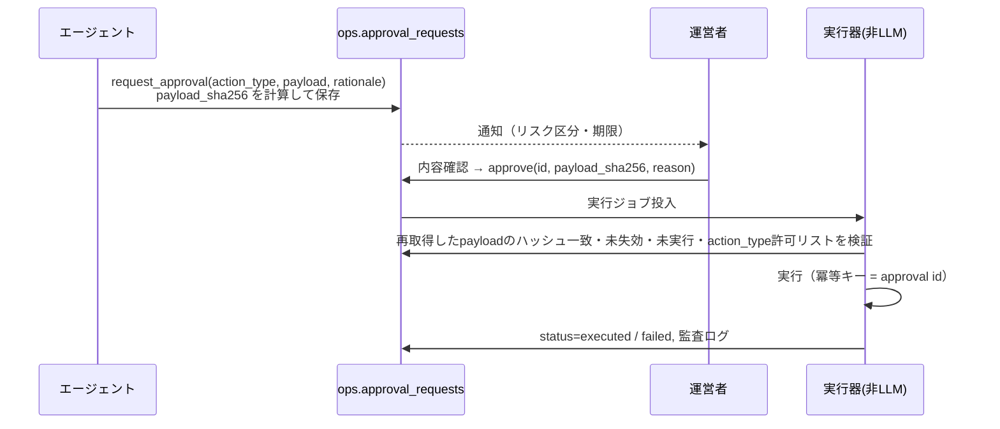

# 9. 自動化対象と人間の承認境界一覧

## 9.1 区分の定義

| 区分 | 意味 | 実装上の扱い |
|---|---|---|
| **AUTO** | AIが自動実行してよい | エージェントのツールとして存在。監査ログ必須 |
| **AUTO-GUARDED** | 条件付き自動。条件を満たさなければ人間へ | 条件は**実行器側（非LLM）で再検証**。AIの自己申告に依存しない |
| **AUTO-STOP** | 安全側（停止方向）のみ自動。再開は人間 | 事前承認済みポリシーとして文書化 |
| **APPROVAL** | 人間の承認が必須 | エージェントは `request_approval` のみ可能。実行器が承認後に実行 |
| **HUMAN** | 人間が直接行う。AIは関与しない（情報提供のみ可） | 対応ツールなし |
| **CUSTOMER** | 顧客自身の判断・操作 | 顧客UIの操作。AIは代行しない |

## 9.2 一覧

### コンテンツ（顧客向け機能）

| 操作 | 区分 | 条件・補足 |
|---|---|---|
| コンテンツ案・本文の下書き生成 | AUTO | 顧客の依頼起点、利用枠・予算内 |
| 機械検査・AIレビュー・主張抽出 | AUTO | |
| 不合格時の再生成 | AUTO-GUARDED | 最大3試行。超過で needs_attention |
| コンテンツの承認 | CUSTOMER | 主張全件確認＋critical解消（または理由付き上書き） |
| 外部公開 | CUSTOMER | MVPは手動コピー／エクスポートのみ。自動投稿機能は将来も「顧客の承認済み版＋顧客の明示操作」必須 |
| 顧客のコンテンツ論理削除 | CUSTOMER | |
| 論理削除後30日の完全削除 | AUTO（D6承認後のポリシー） / 未承認なら APPROVAL | |

### 顧客対応

| 操作 | 区分 | 条件・補足 |
|---|---|---|
| 問い合わせ分類・優先度付け | AUTO | |
| FAQ根拠付き回答の送信 | AUTO-GUARDED | 6章の自動送信条件を全て満たす場合のみ |
| 上記以外の回答 | APPROVAL（回答案→人間が送信） | |
| 返金、請求調整、無償期間付与 | HUMAN | AIは状況整理のみ |
| 契約条件・プラン変更（顧客依頼の代行） | HUMAN | 顧客自身のプラン変更は CUSTOMER（Stripeポータル） |
| 重大な顧客対応（苦情、法的、障害告知、補償） | HUMAN | AIは下書きのみ |
| FAQ記事の公開・更新 | APPROVAL | AIは改善案を作成 |

### 営業・マーケティング

| 操作 | 区分 | 条件・補足 |
|---|---|---|
| 市場調査、競合メモ、コンテンツ案、提案文下書き | AUTO | 出典付き、ops内部保存のみ |
| 自社ブログ・SNSへの公開 | APPROVAL | |
| 営業メール送信（1通でも） | HUMAN（MVP） | 将来の一括送信は APPROVAL＋オプトイン確認済みリストのみ |
| 見込み客リストの外部ツールへの登録 | HUMAN | 法令確認後 |

### 開発・デプロイ

| 操作 | 区分 | 条件・補足 |
|---|---|---|
| ai/* ブランチでの実装・テスト・PR作成 | AUTO | `ai-ready` ラベル付きIssueのみ |
| PRレビューコメント（QA AI） | AUTO | |
| main へのマージ | HUMAN | ブランチ保護＋CI必須＋人間レビュー1名 |
| 本番デプロイ | HUMAN | main マージ＝本番デプロイの場合、マージが承認行為。重大変更（DB変更、認証、課金、権限、エージェント定義）は「本番デプロイ承認」チェックリスト必須 |
| 本番DBマイグレーション | HUMAN | 手動ワークフロー（GitHub Environment の required reviewers） |
| 本番ロールバック | HUMAN | |
| 依存パッケージ更新PR | AUTO（作成）／HUMAN（マージ） | |

### 運営・監視

| 操作 | 区分 | 条件・補足 |
|---|---|---|
| 定期監視、メトリクス集計、レポート作成 | AUTO | |
| 運営者への通知 | AUTO | |
| インシデント起票（下書き） | AUTO | 確定・重大度決定は人間 |
| 予算上限到達時の生成停止、異常テナント一時停止、失敗キュー停止 | AUTO-STOP | 再開は HUMAN |
| 限定的な再試行（ジョブ・API） | AUTO-GUARDED | 8章の回数上限内 |
| 予算増額・上限変更 | APPROVAL | 監視AIが提案可 |
| 機能フラグを有効化（再開） | HUMAN | |
| 重大障害時の復旧・停止範囲の判断 | HUMAN | |

### データ・権限・セキュリティ

| 操作 | 区分 | 条件・補足 |
|---|---|---|
| データエクスポート作成（本人申請） | AUTO | 本人の申請起点 |
| アカウント／ワークスペースデータの完全削除 | APPROVAL | |
| 顧客WS内のロール変更 | CUSTOMER（owner） | |
| 運営者権限（ops.admins）の付与・変更 | HUMAN | オーナーのみ |
| エージェント権限定義の変更 | HUMAN | コード変更＋CODEOWNERSレビュー |
| セキュリティ設定（RLS、CSP、Auth設定、Secrets） | HUMAN | |
| 運営者の顧客データ閲覧 | HUMAN | 顧客同意＋理由＋期限＋監査ログ |

## 9.3 承認ワークフロー仕様（APPROVAL）

| 仕様 | 内容 | テスト |
|---|---|---|
| ハッシュ束縛 | 承認時に画面表示した payload のハッシュを送信。実行時に再計算して一致しなければ実行しない | 承認後に payload を改ざん → 実行拒否 |
| 期限 | `expires_at`（既定72時間、critical は24時間）。失効後は再申請 | 期限切れ承認 → 実行拒否 |
| 1回限り | `executed` 後は再実行不可（冪等） | 二重実行 → 2回目は no-op |
| 申請者≠承認者 | エージェントは承認APIを呼べない（認可で強制） | エージェント資格情報で decide → 403 |
| 却下理由 | 却下時は理由必須。同一内容の再申請は24時間抑止 | |
| 許可リスト | 実行器が扱える `action_type` は列挙済みのもののみ（例: `delete_workspace_data`, `publish_faq_article`, `send_ticket_reply`, `raise_budget`, `publish_marketing_post`） | 未知の action_type → 拒否 |

## 9.4 週1時間運営の内訳（安定稼働後の目標）

| 作業 | 想定時間/週 | 前提 |
|---|---|---|
| 承認キュー処理（回答案送信、FAQ公開、削除承認など） | 15分 | 自動回答率 ≥ 60%、承認案件 ≤ 15件/週 |
| 週次運営レポート確認 | 10分 | 司令塔のサマリが要点を3項目以内に集約 |
| 品質監査サンプル（10件） | 15分 | |
| エスカレーション対応・顧客対応 | 15分 | 顧客数100前後を想定 |
| 開発PRのレビュー・マージ | 5分＋α | 機能開発期は別枠（定常運営に含めない） |

**前提が崩れた場合（顧客数増、障害、品質劣化）は週1時間を超える。品質・安全性を下げて時間を削ることはしない。** ベータ期間は週10–20時間を見込む（[11](11-cost-operations-unverified.md)）。
