# 10. 開発タスク一覧と段階的な実装計画

前提: D1（実装先リポジトリ）が決まり、本設計が承認されてから着手する。工数は1名＋開発AI補助の概算（人日）で、確定値ではない。

## 10.1 フェーズ概要

```mermaid
gantt
  dateFormat  X
  axisFormat  %s
  title 段階的実装（相対週）
  section 基盤
  P0 基盤・CI           :p0, 0, 1
  P1 認証・テナント・RLS  :p1, after p0, 2
  section 中核
  P2 ブランド・コンテンツ・履歴・カレンダー :p2, after p1, 2
  P3 生成・品質検査・評価基盤 :p3, after p2, 3
  P4 課金・利用枠       :p4, after p3, 1
  section 運営
  P5 サポート・承認基盤・管理コンソール :p5, after p4, 2
  P6 監視・コスト・セキュリティ強化 :p6, after p5, 2
  P7 開発AI・営業AI     :p7, after p6, 2
  section 公開前
  P8 クローズドベータ    :p8, after p7, 4
```

各フェーズは「完了条件」をすべて満たしてから次へ進む。各フェーズ末に人間のレビュー（承認）を挟む。

## 10.2 タスク一覧

### P0: 基盤・CI（約4人日）
| ID | タスク | 完了条件 |
|---|---|---|
| P0-1 | 新規リポジトリ作成、Next.js(App Router)/TypeScript strict、ESLint/Prettier | `pnpm lint && pnpm typecheck` 成功 |
| P0-2 | Supabase CLI ローカル環境、マイグレーション雛形 | `supabase start` → `db reset` 成功 |
| P0-3 | GitHub Actions: lint/型/ユニット/RLSテスト/シークレットスキャン | PRで全ジョブ実行 |
| P0-4 | ブランチ保護（main: PR必須、CI必須、レビュー1名、force push禁止）、CODEOWNERS | 設定スクリーンショットを docs に記録 |
| P0-5 | Vercel プロジェクト（Preview/Production 分離）、環境変数台帳（値は記載しない） | Preview デプロイ成功 |
| P0-6 | `lib/llm` 雛形（モックプロバイダ、予算チェックIF、ログ） | ユニットテスト |

### P1: 認証・テナント・RLS（約8人日）
| ID | タスク | 完了条件 |
|---|---|---|
| P1-1 | Supabase Auth（メール/マジックリンク）、ログイン/サインアップ/再設定画面 | E2E: 登録→ログイン |
| P1-2 | `workspaces`/`workspace_members`/`profiles`、作成RPC、ownerトリガ | RLSテスト |
| P1-3 | `is_member`/`has_role` ヘルパー、全テーブルRLS雛形 | 3主体テスト全件成功 |
| P1-4 | RLS未有効テーブル検出のCIチェック | 意図的に無効テーブルを作るとCI失敗 |
| P1-5 | `ops` スキーマ、`ops.audit_logs`（INSERTのみ）、監査ログ関数 | UPDATE/DELETE が拒否される |
| P1-6 | 招待（S） | E2E |

### P2: ブランド・コンテンツ・履歴・カレンダー（約8人日）
| ID | タスク | 完了条件 |
|---|---|---|
| P2-1 | ブランド設定（版管理）画面・API | 版履歴表示、旧版は不変 |
| P2-2 | `contents`/`content_versions`、エディタ（Markdown）、保存=新版 | 差分・復元のテスト |
| P2-3 | ステータス遷移の実装（DB関数で遷移を制約） | 不正遷移が拒否される |
| P2-4 | カレンダー（月/週、D&D） | E2E |
| P2-5 | エクスポート（md/txt）、公開済みマーク | E2E |
| P2-6 | Markdownサニタイズ、CSP | XSSテストケース |

### P3: 生成・品質検査・評価基盤（約15人日）
| ID | タスク | 完了条件 |
|---|---|---|
| P3-1 | `ops.jobs` キュー、ワーカー（SKIP LOCKED、lease、dead） | 並行実行テストで二重処理0 |
| P3-2 | `lib/llm` OpenAI実装、タイムアウト・再試行・予算・`llm_calls` 記録 | 予算超過で拒否されるテスト |
| P3-3 | 案生成・本文生成プロンプト（バージョン管理） | E-core スモーク |
| P3-4 | 機械検査 R-01〜R-13 | ルールごとのユニットテスト（陽性/陰性） |
| P3-5 | 独立AIレビュー（JSONスキーマ、ルーブリック）、主張抽出 | E-reviewer, E-claims の閾値達成 |
| P3-6 | 再生成ループ（最大3試行、最高スコア版の採用） | 統合テスト（モックで不合格を強制） |
| P3-7 | 承認RPC `approve_content`、主張チェックUI、override | 条件未充足で承認不可のテスト |
| P3-8 | 評価ハーネス `evals/`、評価セット初版120ケース作成、CI回帰ゲート | ベースライン記録、劣化PRでCI失敗 |
| P3-9 | 生成状態のUI（ポーリング/Realtime）、needs_attention 表示 | E2E |

### P4: 課金・利用枠（約5人日）
| ID | タスク | 完了条件 |
|---|---|---|
| P4-1 | Stripe テストモードで商品・価格、Checkout、Portal | テストモードでE2E |
| P4-2 | Webhook（署名検証・重複排除）→ `subscriptions` | 再送・順不同イベントのテスト |
| P4-3 | 利用枠集計・超過制御、トライアル終了処理 | 境界値テスト |
| P4-4 | 特商法・規約・プライバシーページ（文面は法務確認待ちのプレースホルダ） | ページ存在 |

### P5: サポート・承認基盤・管理コンソール（約10人日）
| ID | タスク | 完了条件 |
|---|---|---|
| P5-1 | `ops.admins`、MFA必須の管理コンソール骨格 | MFAなしで403 |
| P5-2 | `ops.approval_requests`、承認UI、実行器（ハッシュ束縛・期限・冪等） | 9.3のテスト全件 |
| P5-3 | ヘルプセンター、FAQ管理 | |
| P5-4 | 問い合わせ、顧客対応AI（分類・FAQ回答・回答案・エスカレーション） | E-support 閾値、見逃し0 |
| P5-5 | エージェント基盤 `lib/agents`（許可リスト、AgentContext、上限、ログ、キルスイッチ） | 許可外ツール拒否テスト |
| P5-6 | 機能フラグ / キルスイッチ画面 | フラグOFFで生成が止まるE2E |
| P5-7 | データエクスポート・削除申請フロー | 8.7の手順通りの統合テスト |

### P6: 監視・コスト・セキュリティ強化（約8人日）
| ID | タスク | 完了条件 |
|---|---|---|
| P6-1 | 監視AI（メトリクス集計、閾値、AUTO-STOP） | 予算100%で生成停止の負荷テスト |
| P6-2 | 司令塔（日次/週次サマリ） | サマリ生成、失敗時のテンプレート送信 |
| P6-3 | 外形監視の設定、`/api/health` | 停止検知の確認 |
| P6-4 | インシデント管理画面、runbook（障害対応・秘密ローテーション・復元） | 文書レビュー |
| P6-5 | バックアップ手順と staging への復元訓練1回目 | 所要時間記録 |
| P6-6 | エージェント別DBロール導入（任意・推奨） | 権限テスト |
| P6-7 | セキュリティレビュー（RLS、Auth設定、ヘッダ、依存） | 指摘0 or 対応済み |

### P7: 開発AI・営業AI（約8人日）
| ID | タスク | 完了条件 |
|---|---|---|
| P7-1 | GitHub App（最小権限）、`ai-ready` ラベル起動ワークフロー | ai/* 以外への push が拒否される |
| P7-2 | 開発AIのPRテンプレート・保護パス検出（migrations/workflows/agents） | 保護パス変更でラベル付与 |
| P7-3 | QA AI のPRレビューコメント | |
| P7-4 | 営業AI（調査・案作成、送信機能なし）、管理画面 | 送信系ツールが存在しないことのテスト |

### P8: クローズドベータ（4週間）
| ID | タスク | 完了条件 |
|---|---|---|
| P8-1 | 受け入れテスト（[12](12-mvp-acceptance-and-test-plan.md)）全件 | 合格 |
| P8-2 | 法務確認完了（規約・プライバシー・特商法・広告表現辞書） | 確認記録 |
| P8-3 | **本番環境の構築・本番デプロイ（人間承認）** | 承認記録 |
| P8-4 | 招待制ベータ（5–10事業者）、週次で品質監査・運営時間計測 | KPI記録 |
| P8-5 | 一般公開可否の判断（人間） | 判断記録 |

合計 概算 約66人日＋ベータ4週間。

## 10.3 開発AIに任せる範囲（実装フェーズ中）

- 任せる: 仕様が確定したタスクの実装・テスト追加（P2-4, P2-5, P3-4 の各ルール, P4-3 等）、リファクタ、テストの拡充。
- 人間が主導: RLS・認証・課金・承認実行器・エージェント権限・マイグレーション（設計判断とレビューは人間必須）。
